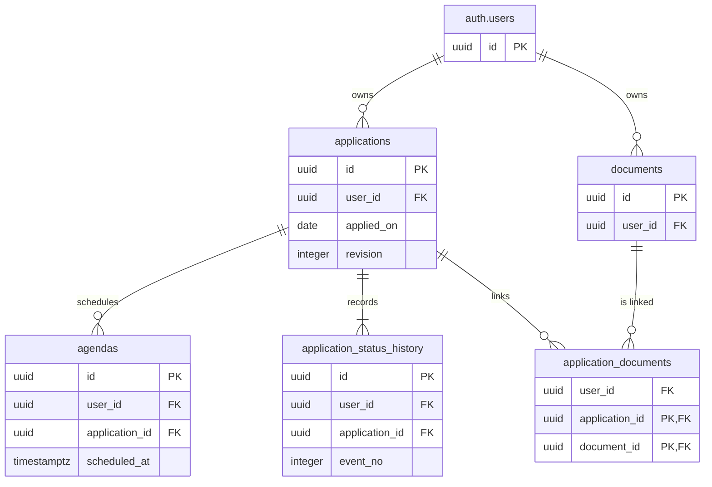

# Kontrak database dan integrasi backend JobTrail

Baseline Flutter di `30db71d`. Migrasi ini menetapkan kontrak PostgreSQL untuk
fase metadata. Supabase Auth mengelola identitas email/password dan menyediakan
`auth.users.id`. Implementasi sesi Flutter, penyedia Auth, dan repository remote
adalah tugas integrasi berikutnya.

## Skema dan relasi

Semua kolom wajib diisi kecuali yang ditandai nullable. Default tabel berlaku
untuk penulisan internal. Default UI tetap mengikuti [kontrak frontend](ARCHITECTURE.md#model-bersama).

| Tabel dan kolom | Tipe dan default | Kontrak Dart dan batasan |
|---|---|---|
| `auth.users.id` | UUID yang diterbitkan Auth | PK, identitas sesi. Email dan metadata akun tetap dikelola Auth. |
| `applications.id, user_id` | UUID, tanpa default | PK dari UUID stabil yang dialokasikan klien, FK pemilik dari sesi. Pasangan `(user_id, id)` unik. |
| `applications.company, position, source, location` | text, tanpa default | Field `ApplicationDraft`. Trim dan tolak teks kosong. `Situs perusahaan` dan `Website perusahaan` tetap nilai berbeda. |
| `applications.applied_on` | date, tanpa default | `appliedAt` sebagai tanggal sipil terbatas, maksimal hari ini di WIB. |
| `applications.status, work_type` | text, tanpa default | `status` dan `workType`, dengan named CHECK untuk kode baku. |
| `applications.salary_monthly_idr` | bigint nullable, NULL | `salary` bulanan dalam IDR, integer nonnegatif. Snapshot mengirim string desimal untuk menjaga presisi. |
| `applications.notes` | text, `''` | `notes`, string kosong valid. |
| `applications.revision` | integer, 1 | Token versi server, positif. Kirim pada edit, perubahan status, dan hapus. |
| `agendas.id, user_id, application_id` | UUID, tanpa default | PK klien, pemilik dari sesi, FK komposit ke lamaran. |
| `agendas.type` | text, tanpa default | `Agenda.type`, kode baku. |
| `agendas.scheduled_at` | timestamptz, tanpa default | `scheduledAt` sebagai instant terbatas. Tanggal WIB minimal tanggal lamaran. |
| `agendas.location_or_link, notes` | text, tanpa default dan `''` | `locationOrLink` wajib nonkosong, `notes` boleh kosong. |
| `application_status_history.id, user_id, application_id` | UUID, `gen_random_uuid()` untuk ID | PK dari server, pemilik dari sesi, FK komposit ke lamaran. |
| `application_status_history.status, changed_at, event_no` | text, timestamptz, integer, dari rutinitas penulisan | `status`, `changedAt`, dan urutan positif yang unik per lamaran. Event baru tidak mundur relatif terhadap event sebelumnya. |
| `documents.id, user_id` | UUID, tanpa default | PK klien dan FK pemilik dari sesi. Pasangan `(user_id, id)` unik. |
| `documents.title, file_name, version, category` | text, tanpa default | `title`, `fileName`, `version` wajib nonkosong. `category` memakai kode baku. Nama file hanya metadata. |
| `documents.updated_at, notes` | timestamptz dari server dan text `''` | `updatedAt` sebagai instant dan `notes` opsional secara isi. |
| `application_documents.user_id, application_id, document_id` | UUID, tanpa default | PK pasangan ID dan dua FK komposit dengan pemilik yang sama. Repository membentuk kembali `Application.documentIds` dari set ini. |
| `applications.create_fingerprint`, `agendas.create_fingerprint`, `documents.create_fingerprint` | bytea, dibuat RPC | SHA-256 payload pembuatan yang dikanonisasi. Kolom internal dan tetap setelah edit. |

Kode status dipetakan langsung dari `RecruitmentStatus.name` dengan nilai
`applied`, `screening`, `test`, `interview`, `offering`, `rejected`.
`WorkType.onSite` menjadi `on_site`, sedangkan `hybrid` dan `remote` langsung.
`AgendaType` menggunakan `interview` dan `test`.
`DocumentCategory.cvResume` menjadi `cv_resume`, sedangkan `portfolio` langsung.
Kirim tanggal sebagai `YYYY-MM-DD` dan bangun ulang dengan `AppDates.date`.
Kirim instant ISO 8601 dengan offset eksplisit, parse ke UTC. Tanggal WIB dihitung
dengan offset tetap UTC+07 agar cocok dengan [AppDates](../lib/core/constants/app_dates.dart).

Lamaran dan dokumen dimiliki akun. Hapus lamaran menghapus agenda, history,
dan tautan, dengan dokumen tetap tersimpan. FK dokumen menolak penghapusan
selama masih ada tautan. Hapus akun menghapus data milik akun melalui cascade.
Primary key dan unique constraint menyediakan indeks identitas. Indeks tambahan
mendukung daftar per pemilik berdasarkan tanggal lamaran, jadwal dan dokumen,
agenda dan history per lamaran, serta pencarian balik tautan dokumen.

## Akses dan kontrak repository

RLS menyediakan SELECT per pemilik untuk `authenticated`. Proyeksi eksplisit
diperlukan untuk tabel yang memiliki fingerprint. Gunakan snapshot RPC sebagai
antarmuka baca utama. Perubahan melalui RPC menggunakan role `jobtrail_mutator`
yang tidak memiliki login, tabel, atau BYPASSRLS. RLS berlaku juga untuk role itu.
Kolom pemilik dan fingerprint tidak mendapat izin UPDATE. Pemanggil anonim
tidak mendapat akses tabel atau RPC. Jembatan privat hanya membaca identitas
`auth.uid()` karena role migrasi Supabase tidak bisa mendelegasikan akses skema Auth.

| Metode repository | RPC dan input | Output |
|---|---|---|
| `loadSnapshot()` | `jobtrail_load_snapshot` tanpa argumen | `reference_date`, `reference_instant`, dan array `applications`, `agendas`, `history`, `documents`, `application_documents`. Field DTO memakai nama kolom publik pada kamus, tanpa `user_id` dan fingerprint. Gaji berupa string desimal atau null. |
| `createApplication(id, draft)` | `jobtrail_create_application` dengan `p_id`, perusahaan, posisi, sumber, tanggal, status, lokasi, tipe, gaji, catatan, dan `p_document_ids` | `id`, `revision`, `replayed`. Pembuatan lamaran, tautan dan event pertama terjadi dalam satu transaksi. |
| `updateApplication(id, revision, draft)` | `jobtrail_update_application`. Payload lengkap sama seperti create dengan `p_expected_revision`. Kirim null untuk gaji kosong dan array kosong untuk melepaskan semua dokumen. | `id`, `revision` baru. Payload, tautan, dan event status bersifat atomik. |
| `changeStatus(id, revision, status)` | `jobtrail_change_status(p_id, p_expected_revision, p_status)` | `id`, `revision`. Status sama mempertahankan revisi dan history. |
| `deleteApplication(id, revision)` | `jobtrail_delete_application(p_id, p_expected_revision)` | UUID yang dihapus. |
| `saveAgenda(id, mode, draft)` | `jobtrail_save_agenda(p_id, p_create, p_application_id, p_type, p_scheduled_at, p_location_or_link, p_notes)` | `id`, `replayed`. Mode edit mempertahankan ID dan hanya dapat pindah ke lamaran pemilik yang sama. |
| `saveDocument(id, mode, draft)` | `jobtrail_save_document(p_id, p_create, p_title, p_category, p_file_name, p_version, p_notes)` | `id`, `updated_at`, `replayed`. Timestamp dari server. |
| `deleteAgenda(id)`, `deleteDocument(id)` | `jobtrail_delete_agenda(p_id)`, `jobtrail_delete_document(p_id)` | UUID yang dihapus. |

Nama parameter draft RPC memakai awalan `p_` di depan nama kolom kamus.
Store menggunakan snapshot konsisten dan mempublikasikan state setelah commit.
Jika refresh gagal setelah commit, ulangi baca dan pertahankan hasil commit.
W13-02 memakai ID hasil commit untuk membuka Board. Store dan navigasi dipasang
per sesi, dibuang saat identitas berubah, serta mengabaikan request sesi lama.
Tampilkan state loading, empty, dan error/retry terpisah. Gunakan satu adapter
bersama dan pertahankan in-memory repository untuk pengujian dan demo.

**Retry.** Buat UUID sekali per percobaan create. ID dan payload awal yang cocok
memberikan `replayed: true` selama row masih ada, termasuk setelah edit.
Hasil replay memuat revisi atau timestamp terkini dan tidak menulis ulang data.
Urutan tautan dokumen diabaikan. Duplikat atau null dalam daftar ditolak.
ID yang dipakai dengan payload berbeda menghasilkan konflik. Jangan kirim ulang
create yang sudah diketahui terhapus. Penghapusan permanen tidak menyimpan
tombstone, sehingga server tidak mengingat ID tersebut setelah row dihapus.
Pertahankan kanonisasi payload lama jika kontrak create berubah.
Untuk edit yang mengalami timeout, baca ulang sebelum mencoba dengan revisi baru.

| SQLSTATE | Penanganan di adapter |
|---|---|
| `42501` | Sesi atau akses ditolak. Hentikan write dan periksa status autentikasi. |
| `JT001` | Record tidak tersedia. Gunakan pesan sama untuk ID hilang dan ID milik akun lain. |
| `JT002` | Revisi stale. Ambil snapshot baru dan pertahankan draft pengguna. |
| `JT003` | Tautan dokumen tidak tersedia. Muat inventori lagi dan minta pilihan ulang. |
| `JT004` | ID create konflik. Jangan retry payload berbeda dengan ID lama. |
| `JT005` | Dokumen masih tertaut. Lepas tautan sebelum menghapus. |
| `22023`, `23502`, `23514`, tipe input invalid | Tampilkan kesalahan validasi yang sesuai tanpa menampilkan pesan database mentah. |
| `40001`, timeout atau offline | Ambil ulang state atau retry terkontrol. Pakai ID dan payload asli untuk retry create. |

## Akses per screen

| Screen | Operasi data |
|---|---|
| S01 Home | Baca aplikasi dan agenda, hitung target dan notifikasi. Read marker notifikasi lokal. |
| S02 Board | Baca aplikasi, agenda, dan metadata dokumen tertaut, ubah status. |
| S03 Detail | Baca lamaran, agenda, history, dokumen dan tautan, ubah status, hapus lamaran, buat agenda. |
| S04 Add/Edit | Baca draft dan dokumen, buat atau ubah lamaran beserta tautan dan history. |
| S05 Jadwal | Baca agenda dan lamaran, buat agenda. Endpoint edit/delete tersedia untuk integrasi mendatang. |
| S06 Dokumen | Baca, buat, ubah, hapus metadata, dan baca referensi aplikasi. |
| S07 Statistik | Baca lamaran dan history, hitung metrik sesuai [definisi saat ini](DUMMY_DATA.md#definisi-agregasi-yang-sudah-diimplementasikan). |
| Auth | Sesi, register/login email, verifikasi, dan recovery lewat Auth. |

## Keputusan tertunda

- `setWeeklyGoal` ada di store tetapi tidak dipanggil screen, sehingga release
  awal menghitung Senin WIB dan default 8 tanpa tabel baru. Pertahankan API demo.
  Jika target bisa diedit atau berbeda per minggu, setujui penyimpanan preferensi
  atau target mingguan sebelum menghubungkan UI editor.
- Eligibility agenda dan batas tahun picker saat ini aturan UI. Database menjaga
  kepemilikan dan relasi tanggal. Setujui promosi eligibility ke server bila perlu.
- Tautan dokumen tidak menyimpan urutan UI. Penyatuan label sumber dan urutan
  tautan memerlukan keputusan produk. Sepakati batas nilai gaji yang dapat
  ditangani layar Web sebelum mengubah string desimal menjadi Dart `int`.
- Google OAuth, file privat, offline, realtime, dan persistensi read marker
  ditunda. Verifikasi Auth email/password, PostgREST, dan kebijakan penghapusan
  akun pada stack Supabase lokal saat pekerjaan integrasi dimulai.

## Pengujian lokal

Jalankan hanya pada database lokal disposable. Pada Supabase lokal yang memiliki
skema Auth, terapkan migrasi berurutan lalu jalankan
`psql -X -h 127.0.0.1 -p PORT_LOKAL -v ON_ERROR_STOP=1 -f supabase/tests/database_contract.sql`
dengan user dan database lokal yang sesuai. Tes memakai fixture sementara di dalam transaksi yang diakhiri
ROLLBACK. Untuk PostgreSQL polos pada cluster baru, jalankan terlebih dahulu
`supabase/tests/support/plain_postgres_auth.sql` sebagai admin. Harness ini
mensimulasikan role dan claim request. Ia menguji PostgreSQL dan RLS pada
level SQL, sedangkan autentikasi dan API HTTP Supabase perlu diuji terpisah.
